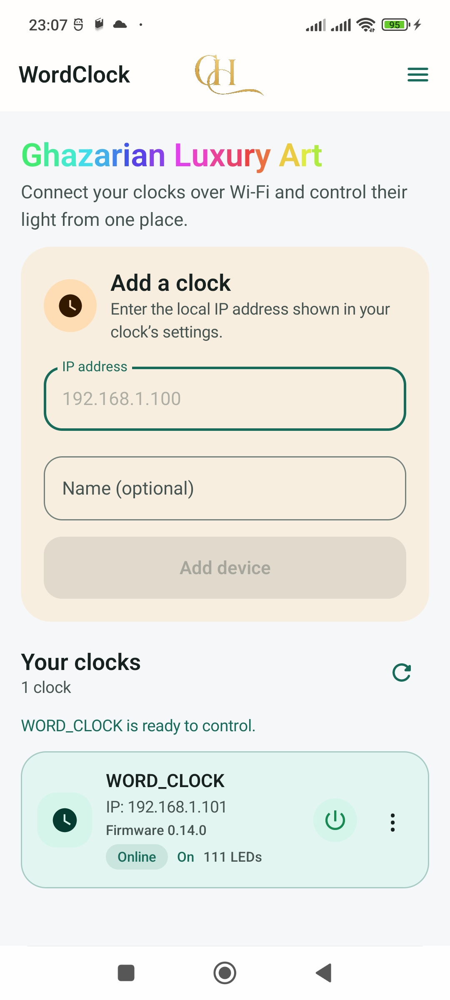
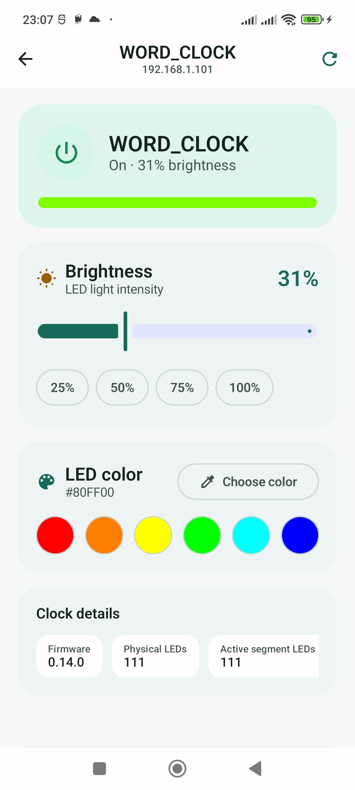
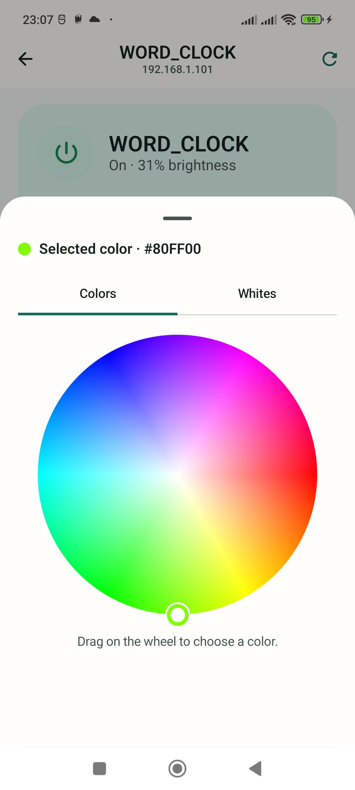
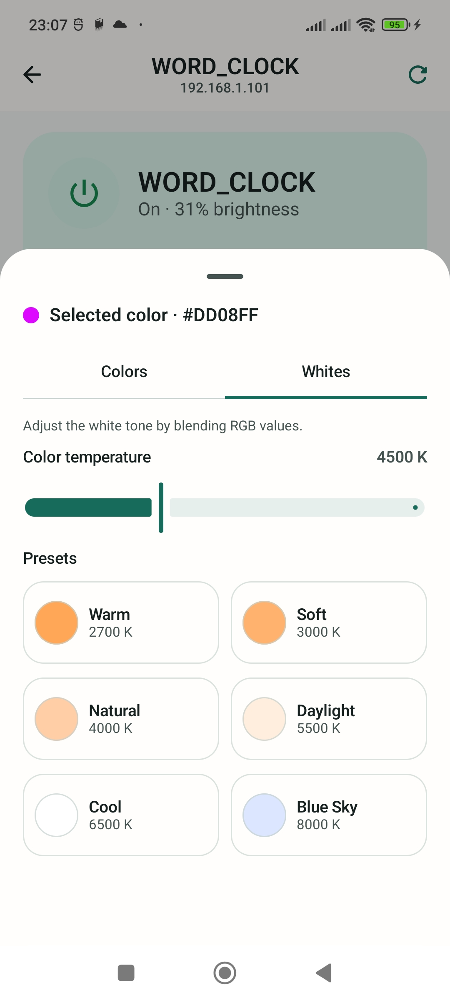
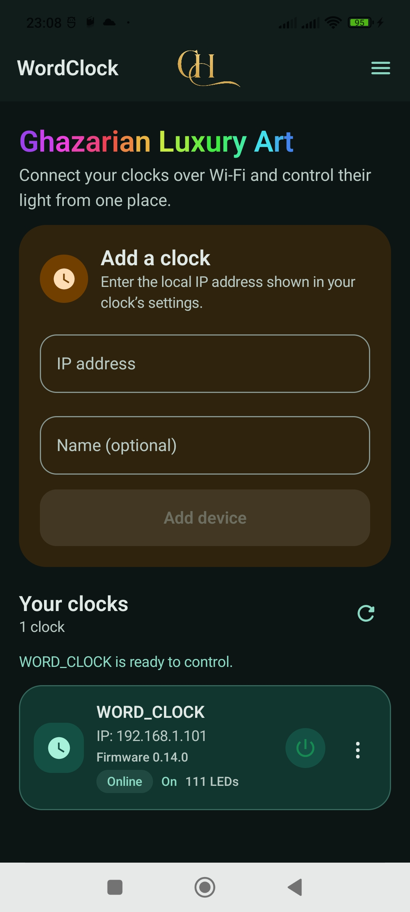

# WordClock

اپلیکیشنی برای افزودن و کنترل چند ساعت Word Clock مبتنی بر ESP32 از طریق شبکهٔ محلی Wi-Fi. برنامه
اطلاعات ساعت را از API سازگار با WLED می‌خواند و کنترل روشنایی و رنگ LEDها را در Android و iOS فراهم
می‌کند.

منطق مدل، دامنه، شبکه، ذخیره‌سازی و عملیات دستگاه تا حد امکان با Kotlin Multiplatform مشترک است.
رابط Android با Jetpack Compose و رابط iOS به‌صورت native با SwiftUI پیاده‌سازی شده‌اند.

## امکانات

- افزودن چند ساعت با واردکردن IP محلی و نام دلخواه.
- نمایش وضعیت اتصال، IP، نسخهٔ firmware و تعداد LEDها؛ تازه‌سازی اطلاعات و تشخیص وضعیت
  آنلاین/آفلاین.
- روشن و خاموش‌کردن ساعت، تغییر نام و حذف دستگاه.
- کنترل زندهٔ روشنایی با slider و مقادیر آمادهٔ ۲۵، ۵۰، ۷۵ و ۱۰۰ درصد.
- انتخاب رنگ زنده با چرخ رنگ، رنگ‌های آماده و presetهای سفید با دمای رنگ قابل تنظیم.
- نمایش جزئیات firmware و LEDهای ساعت در صفحهٔ کنترل.
- حالت‌های روشن، تاریک و پیروی از سیستم؛ انتخاب زبان فارسی یا انگلیسی.
- ذخیرهٔ محلی فهرست دستگاه‌ها و تنظیمات ظاهری.
- پشتیبانی از چیدمان‌های واکنش‌گرا و دسترس‌پذیری وضعیت شبکه در هر دو پلتفرم.

## تصاویر برنامه

تصاویر زیر از نسخهٔ Android برنامه هستند و در `doc/` نگهداری می‌شوند.

<table>
  <tr>
    <td align="center">فهرست ساعت‌ها – روشن<br></td>
    <td align="center">کنترل ساعت<br></td>
    <td align="center">انتخاب رنگ<br></td>
  </tr>
  <tr>
    <td align="center">دمای رنگ سفید<br></td>
    <td align="center">فهرست ساعت‌ها – تاریک<br></td>
  </tr>
</table>

## سازگاری ساعت و شبکه

ساعت باید APIهای JSON مورد استفادهٔ WLED را ارائه کند، از جمله `/json/info` و `/json/state`. گوشی و
ساعت باید روی شبکه‌ای باشند که ارتباط محلی بین آن‌ها را مجاز می‌کند. برنامه برای این کنترل‌ها از
اینترنت یا سرویس ابری استفاده نمی‌کند.

## ساختار پروژه

```text
app/                 برنامهٔ Android، نقطهٔ ورود، Hilt و Navigation
iosApp/              رابط native iOS با SwiftUI و پروژهٔ Xcode
shared/              SDK Kotlin برای اتصال اپ iOS به قابلیت‌های مشترک
core/
  model/             مدل‌های مشترک دستگاه، وضعیت و رنگ
  domain/            قرارداد repository و use caseها
  network/           ارتباط Ktor با API ساعت
  data/              پیاده‌سازی repository دستگاه‌ها
  storage/           ذخیره‌سازی تنظیمات و دستگاه‌ها با DataStore
  resources/         رشته‌های مشترک انگلیسی و فارسی
  designsystem/      تم و اجزای طراحی Android
  testing/           fakeها و ابزارهای تست مشترک
feature/
  devices/           صفحه و منطق رابط Android برای فهرست دستگاه‌ها
  control/           صفحه و منطق رابط Android برای کنترل ساعت
```

در Android، هر feature رابط Compose و ViewModel خودش را دارد. در iOS، `AppModel` و صفحه‌های SwiftUI
از طریق `shared` به همان domain و data layer مشترک متصل می‌شوند. متن‌های مشترک در منابع
`core/resources` قرار دارند.

## پیش‌نیازها

- Android Studio و Android SDK، نسخهٔ API 37 برای build پروژه.
- JDK 17.
- برای اجرای Android: دستگاه یا emulator با Android 8.0 (API 26) یا بالاتر.
- برای build یا اجرای iOS: macOS و Xcode؛ حداقل نسخهٔ iOS پروژه 16.0 است. ساخت و اجرای iOS روی
  Windows پشتیبانی نمی‌شود.

نسخه‌های Gradle و کتابخانه‌ها در `gradle/wrapper/gradle-wrapper.properties` و
`gradle/libs.versions.toml` تعریف شده‌اند.

## اجرای Android

1. پروژه را در Android Studio باز و Gradle Sync را کامل کنید.
2. یک گوشی یا emulator انتخاب کنید و برنامهٔ `app` را اجرا کنید.

برای ساخت APK از PowerShell در ریشهٔ پروژه:

```powershell
.\gradlew.bat :app:assembleDebug
```

برای کنترل یک ساعت واقعی، گوشی و ساعت را به شبکهٔ Wi-Fi یکسان وصل کنید و IP محلی ساعت را در صفحهٔ
اصلی وارد کنید.

## اجرای iOS

روی Mac، پروژهٔ `iosApp/WordClock.xcodeproj` را با Xcode باز کنید، scheme با نام `WordClockIOS` را
انتخاب کنید و مقصد iOS Simulator یا دستگاه را اجرا کنید. ماژول Kotlin/Native در build پروژه به‌عنوان
framework استفاده می‌شود. برای اجرای روی iPhone واقعی، امضای معمول Xcode نیز لازم است.

## آزمون‌ها

آزمون‌های واحد در ماژول‌های `core/model`، `core/domain`، `core/data` و `feature/control` قرار دارند.
آزمون‌های iOS Simulator به macOS و Xcode نیاز دارند.
